# Campus Club Finder - Documentation

This document walks through the app from its initial state, page by page, with a screenshot for
each main step. Screenshots live in [`docs/screenshots`](./docs/screenshots).

## 1. Initial state

On first visit nothing is stored in `localStorage`, so no club has been joined. The app opens on the
**Home** page. The navbar (Home, Clubs, About) is shown on every page and highlights the current page.

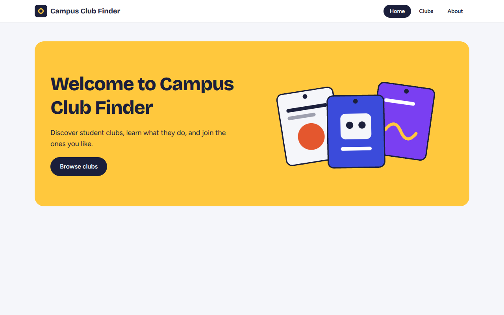

The Home page has a welcome message, a short description, a hero illustration, and a
**Browse clubs** button that goes to `/clubs`.

## 2. Club List page (`/clubs`)

Clicking **Browse clubs** (or **Clubs** in the navbar) opens all 5 clubs as cards. Each card shows
the club image, name, short description, and a **View Details** link.

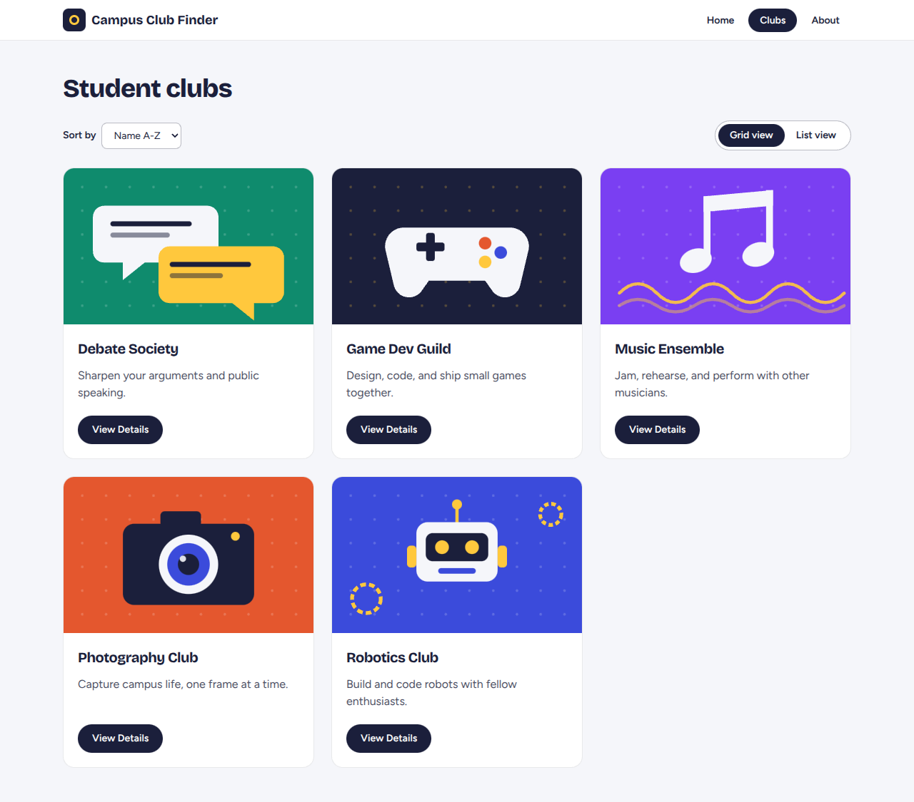

### Sorting

The **Sort by** dropdown offers **Name A-Z** (default) and **Name Z-A**. The screenshot shows Name Z-A.

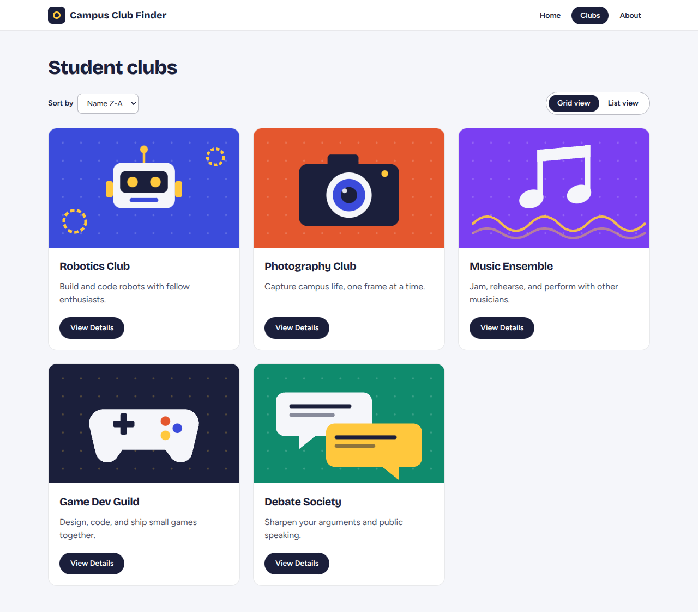

### Grid / List view toggle

The toggle switches between cards in a grid and cards stacked vertically. The selected option is
highlighted.

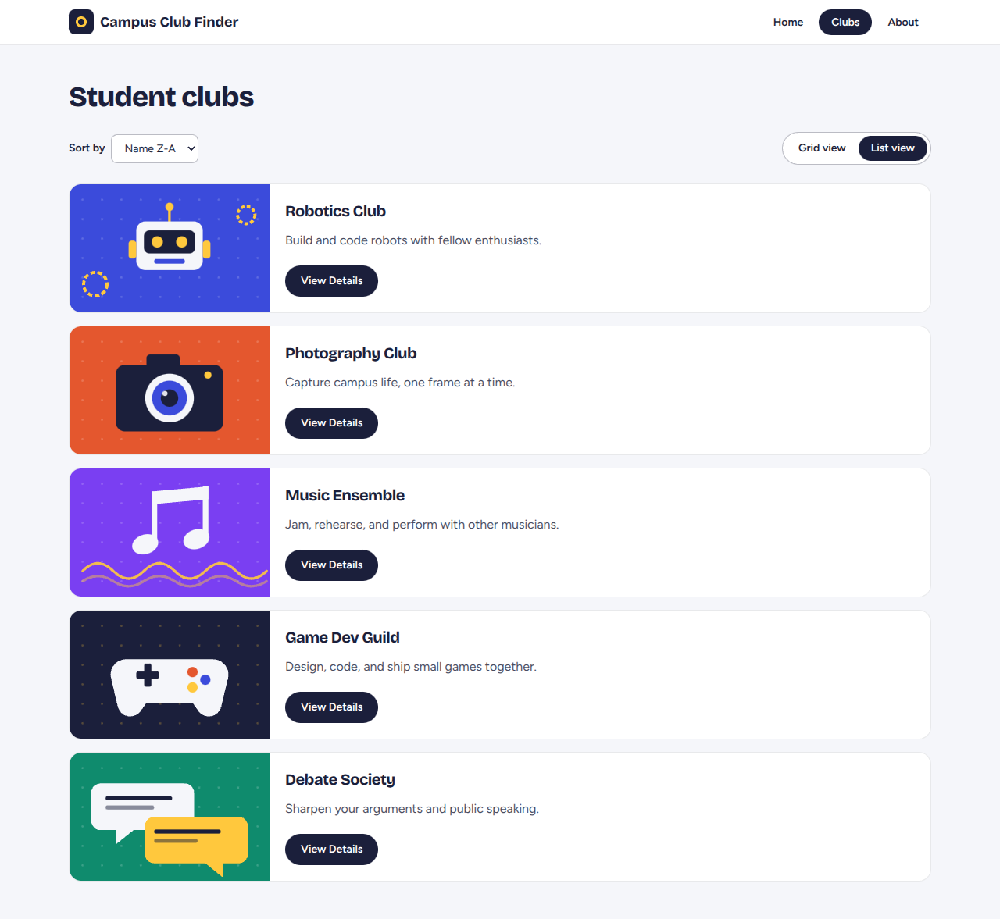

### Responsive layout

The grid shows 3 columns on desktop, 2 on tablet, and 1 on mobile.

| 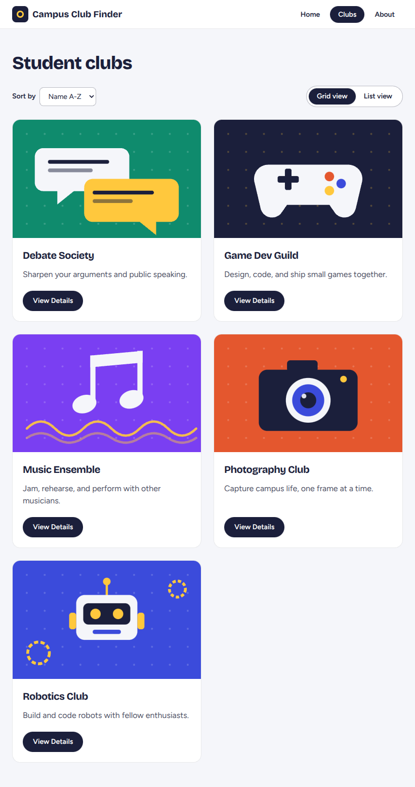 | 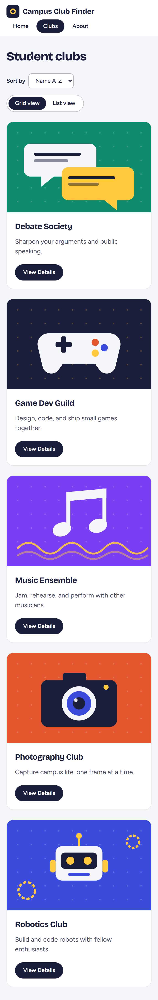 |

## 3. Club Detail page (`/clubs/:clubId`)

**View Details** opens the club page: large image, full description, and the upcoming events with
their dates. The **Join Club** button is enabled because the club has not been joined yet.

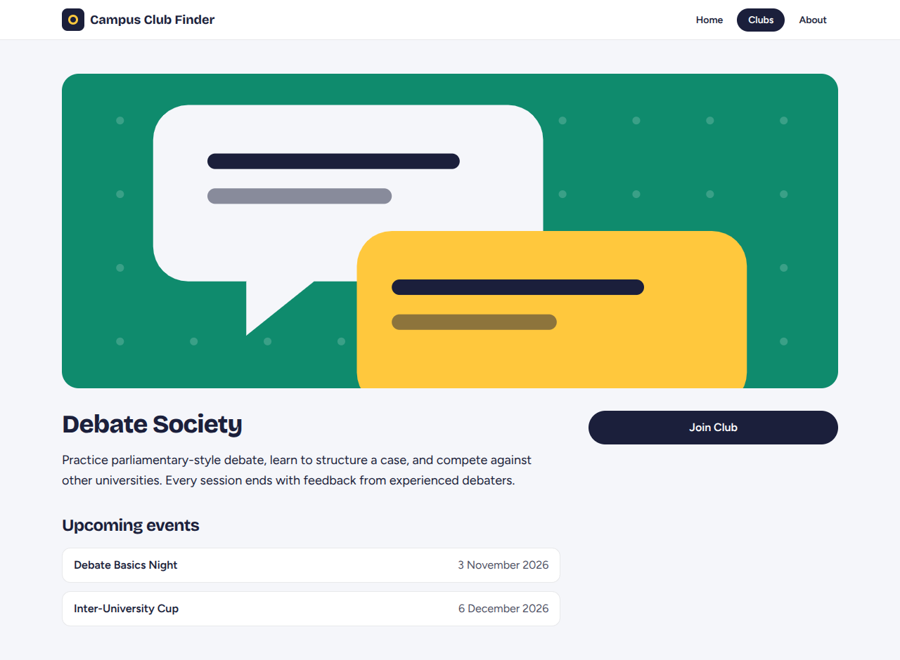

### Joining a club

Clicking **Join Club** saves the club id in `localStorage`, shows a confirmation message, and
changes the button to a disabled **You have joined this club!**.

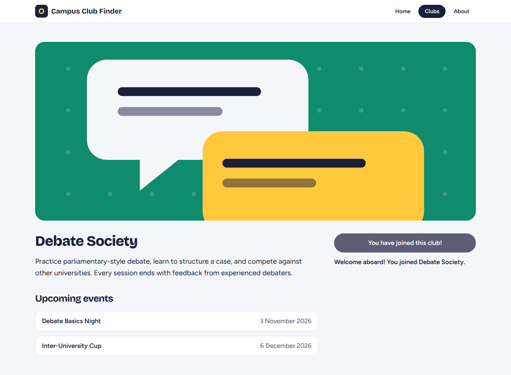

### Persistence

After reloading the page the club is still joined, because the state is read back from `localStorage`.

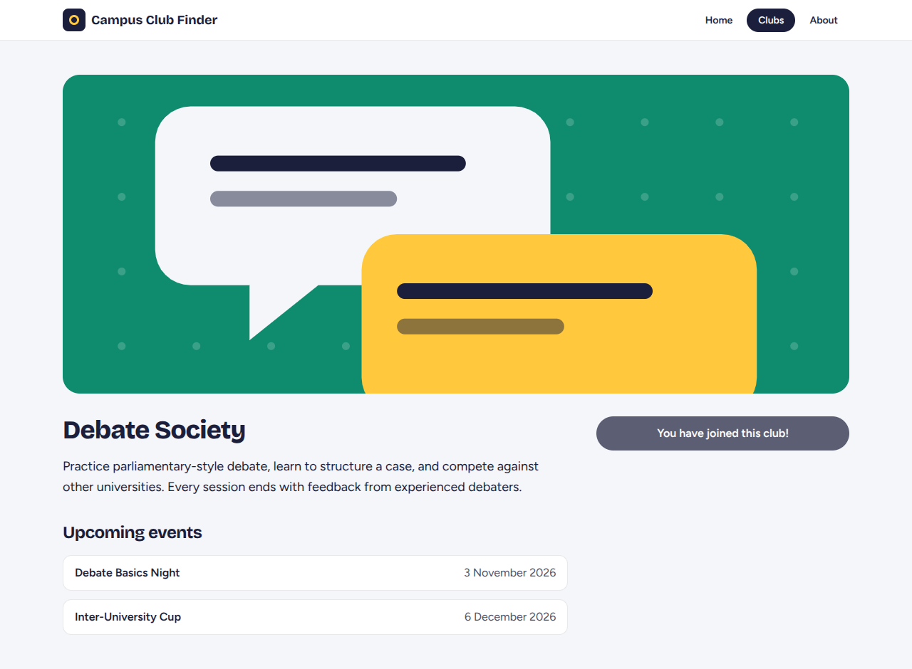

Club detail on mobile:

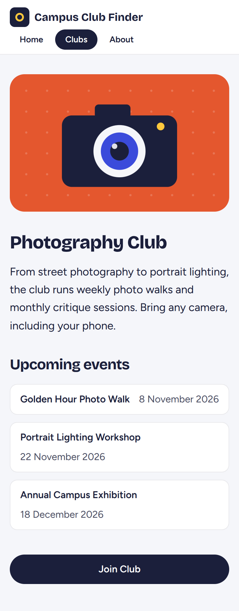

## 4. About page (`/about`)

Explains what the app does and lists the tech stack: Vite, React, React Router, and Tailwind CSS.

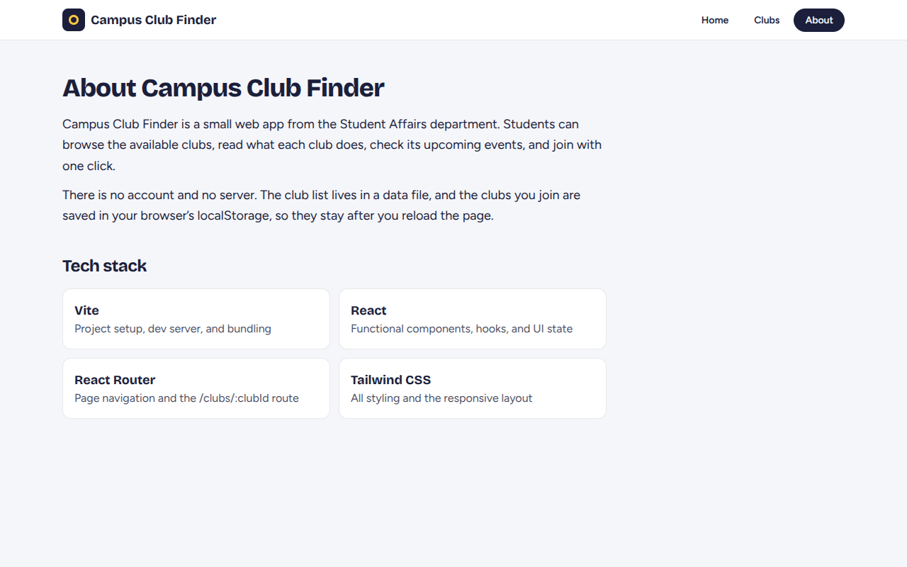

## 5. 404 Not Found (`*`)

Any unknown URL shows a friendly message and a **Back to Home** button. An invalid club id such as
`/clubs/unknown-club` shows the same page.

| Unknown route | Unknown club id |
| --- | --- |
| 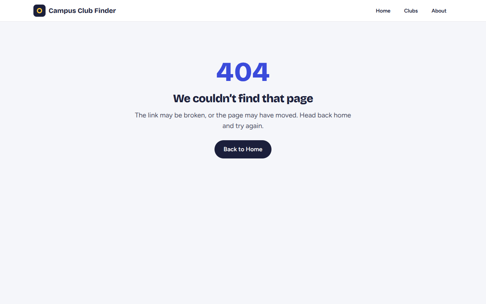 | 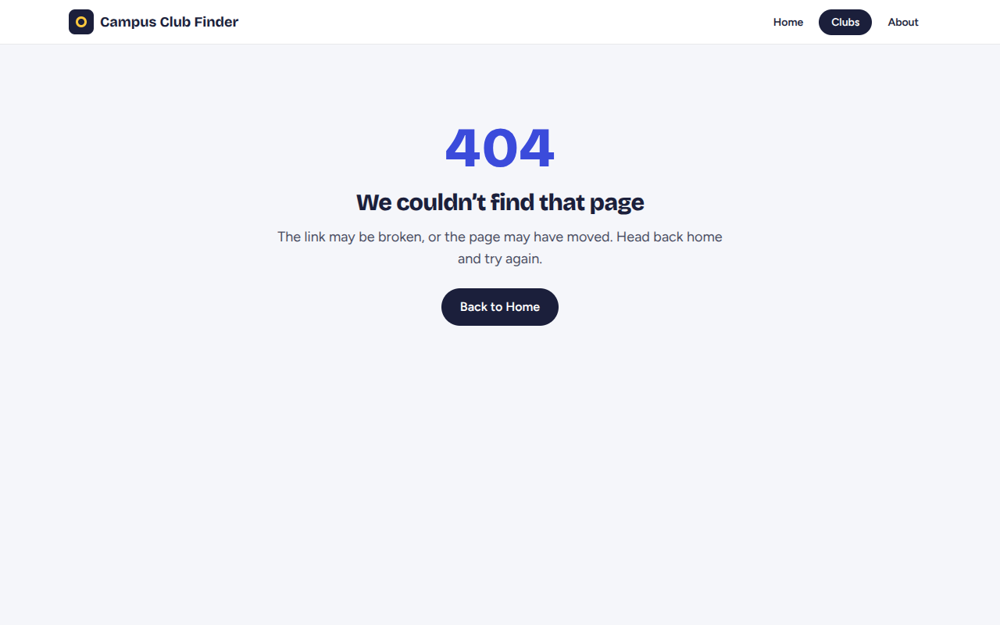 |

## 6. Mobile home

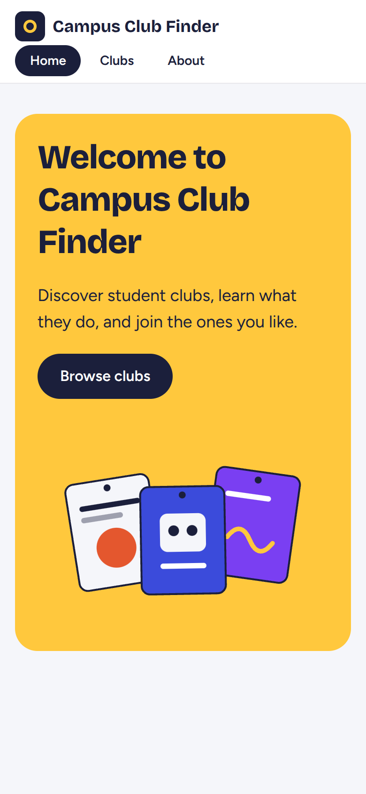
